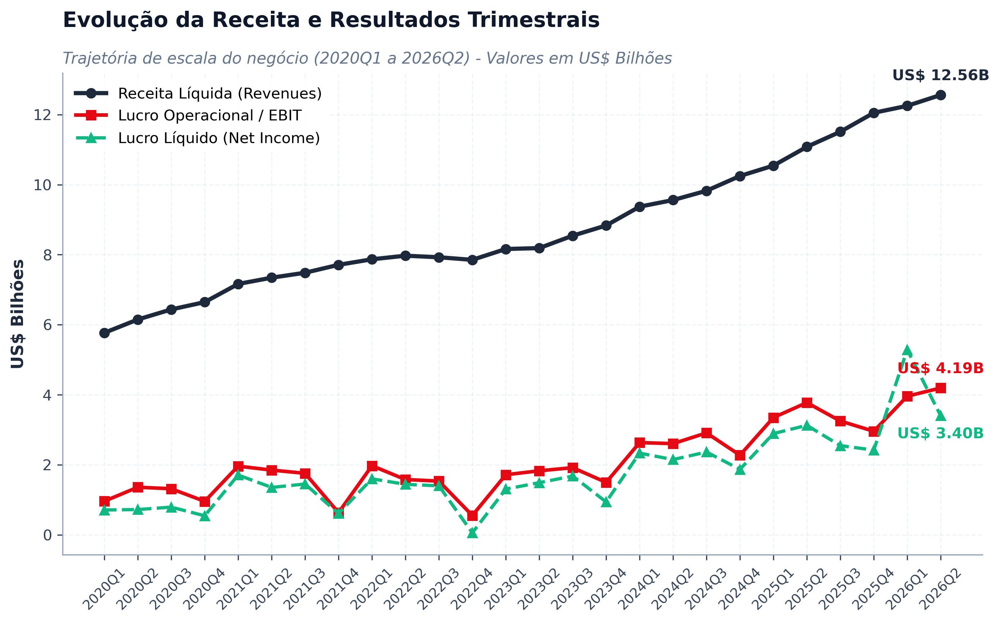
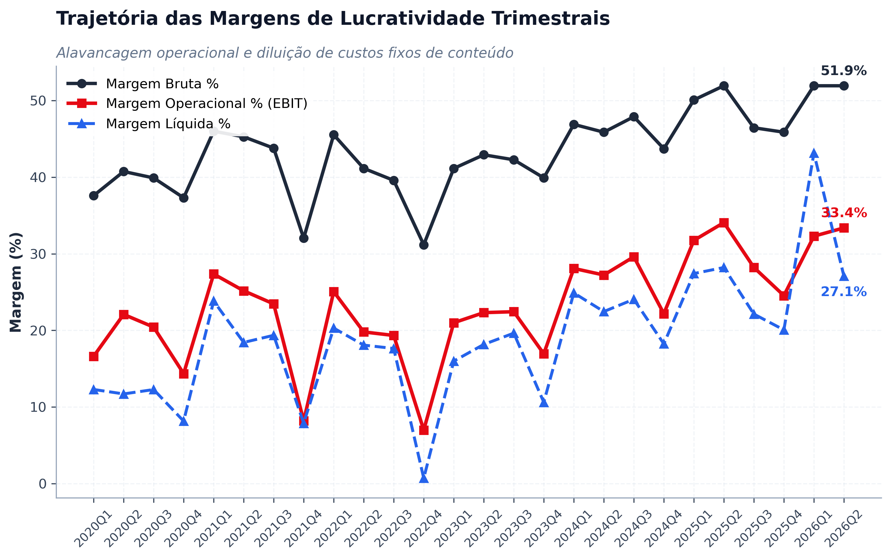
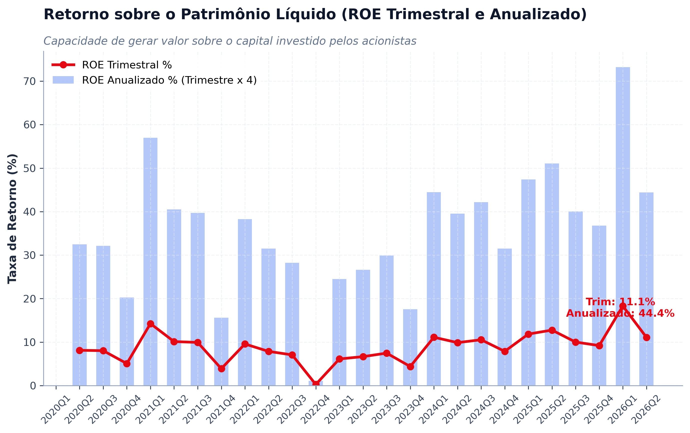
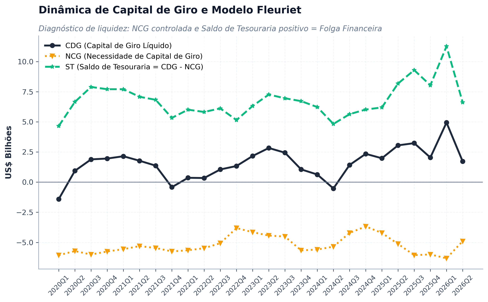
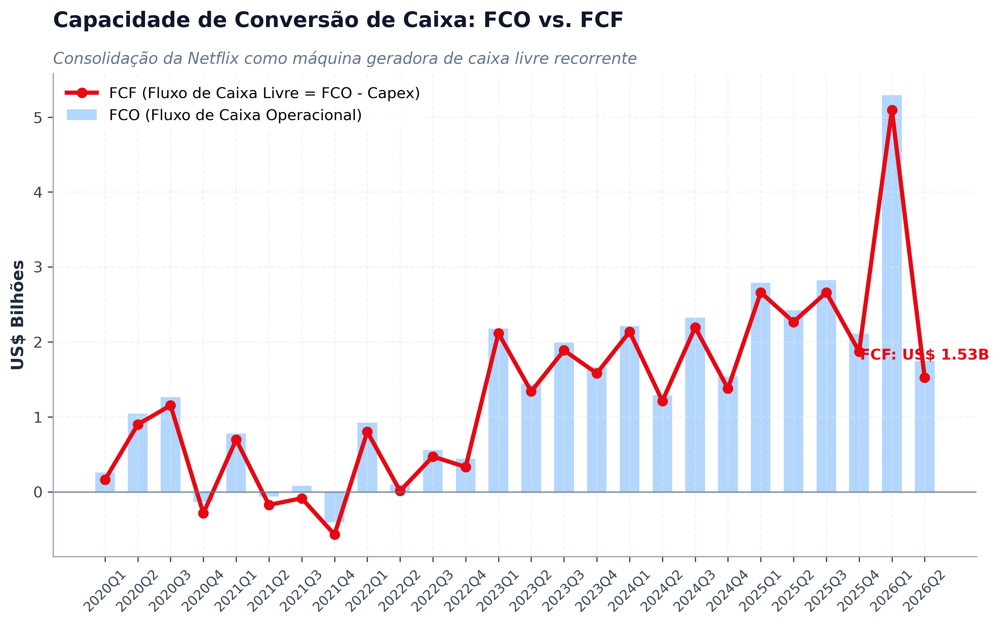
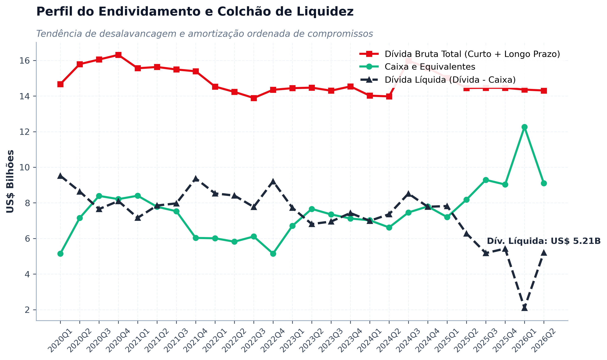
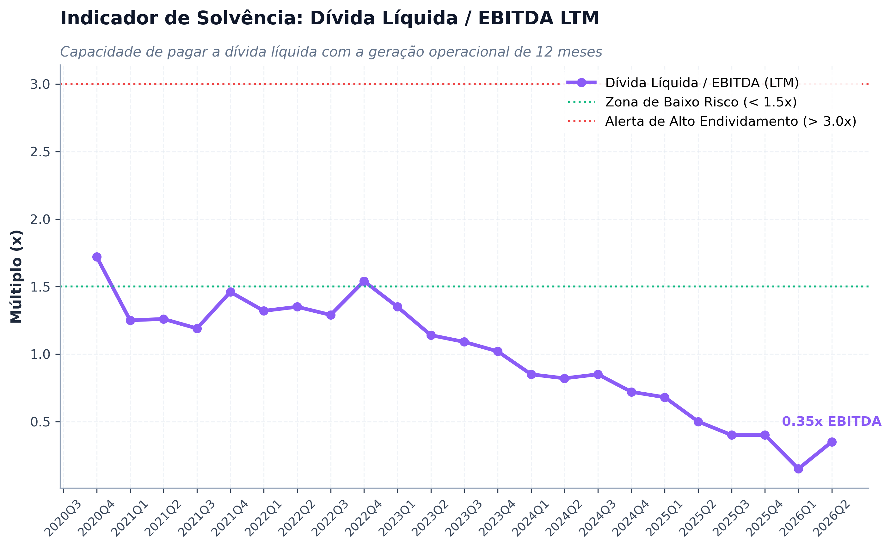
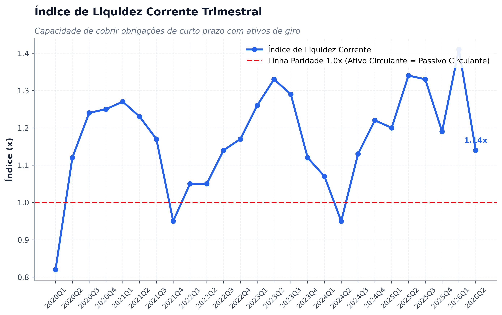

# 📊 Análise das Demonstrações Financeiras (ADF): Netflix, Inc. (NFLX)

Projeto completo de **Análise Fundamentalista e Diagnóstico Financeiro Trimestral** da **Netflix, Inc. (NASDAQ: NFLX)** cobrindo o período histórico de **2020Q1 até o trimestre mais recente disponível (2026)**, construído diretamente sobre os dados contábeis oficiais da **SEC EDGAR** (*Forms 10-Q e 10-K*).

---

## 🎯 Destaques do Projeto

* 🏛️ **Ingestão Oficial SEC EDGAR:** Conexão direta com a API REST da SEC (`data.sec.gov`), com tratamento de *User-Agent* institucional, desdobramento contábil discreto de trimestres (*implied 4th quarter* do 10-K) e reconciliação de saldos instantâneos (Balanço) e fluxos de duração (DRE e DFC).
* 📐 **Alinhamento Metodológico Rigoroso:** 100% aderente aos padrões contábeis e à planilha acadêmica de referência (`Planilhas ECO057.xlsx`):
  * **Análise Vertical (AV):** Base 100% na Receita Líquida (DRE) e Ativo Total (Balanço).
  * **Análise Horizontal (AH):** Variações Trimestre a Trimestre (QoQ) e Homóloga Ano contra Ano (YoY).
  * **Rentabilidade e Retorno:** Margens Bruta, Operacional (EBIT) e Líquida, além de ROE Trimestral e Anualizado.
  * **Dinâmica Financeira e Capital de Giro:** Modelo Fleuriet completo (CDG, NCG e Saldo de Tesouraria - ST).
  * **Estrutura de Capital e Alavancagem:** Endividamento Total, Caixa, Dívida Líquida, Dívida Líquida / EBITDA LTM, e Graus de Alavancagem (GAO, GAF e GAT).
* 🖼️ **Gráficos Slide-Ready (Widescreen 16:9 - 300 DPI):** Exportação automatizada de 8 gráficos analíticos individuais de alta resolução na pasta [`graficos_slides/`](./graficos_slides/), prontos para cópia e colagem direta em apresentações executivas.

---

## 📁 Estrutura do Repositório

```text
├── Analise_Demonstracoes_Financeiras_NFLX_vs_DIS.ipynb  # Notebook interativo completo
├── adf_nflx_vs_dis.py                                   # Script Python modular autônomo
├── graficos_slides/                                     # Gráficos individuais (300 DPI / 16:9)
│   ├── 01_receita_ebit_lucro_liquido.png
│   ├── 02_margens_rentabilidade.png
│   ├── 03_retorno_roe.png
│   ├── 04_modelo_fleuriet.png
│   ├── 05_geracao_caixa_fcf.png
│   ├── 06_estrutura_divida.png
│   ├── 07_alavancagem_divida_ebitda.png
│   └── 08_liquidez_corrente.png
├── painel_nflx_trimestral.png                           # Painel gráfico consolidado (2x2)
├── Planilhas ECO057.xlsx                                # Planilha metodológica de referência
├── historico_conversa_analise_sec_nflx_dis.md           # Diário de bordo e fundamentação teórica
├── .gitignore
└── README.md
```

---

## 📈 Galeria de Gráficos Analíticos (Slide-Ready)

| 1. Escala e Resultados (Receita vs. Lucros) | 2. Trajetória das Margens (%) |
| :---: | :---: |
|  |  |

| 3. Retorno do Acionista (ROE %) | 4. Modelo Fleuriet (CDG, NCG e ST) |
| :---: | :---: |
|  |  |

| 5. Conversão de Caixa (FCO vs. FCF) | 6. Estrutura de Dívida e Caixa |
| :---: | :---: |
|  |  |

| 7. Solvência: Dívida Líquida / EBITDA LTM | 8. Liquidez Corrente |
| :---: | :---: |
|  |  |

---

## 🚀 Como Executar

### Pré-requisitos

Instale os pacotes necessários:
```bash
pip install pandas numpy matplotlib requests openpyxl ipykernel
```

### Execução via Python Script
```bash
python adf_nflx_vs_dis.py
```

### Execução via Jupyter Notebook
Abra o arquivo `Analise_Demonstracoes_Financeiras_NFLX_vs_DIS.ipynb` no VS Code ou Jupyter Lab e execute as células sequencialmente.

---

## 📌 Autor
Desenvolvido por **Eurico Júnior** ([@Euricojr](https://github.com/Euricojr)).
